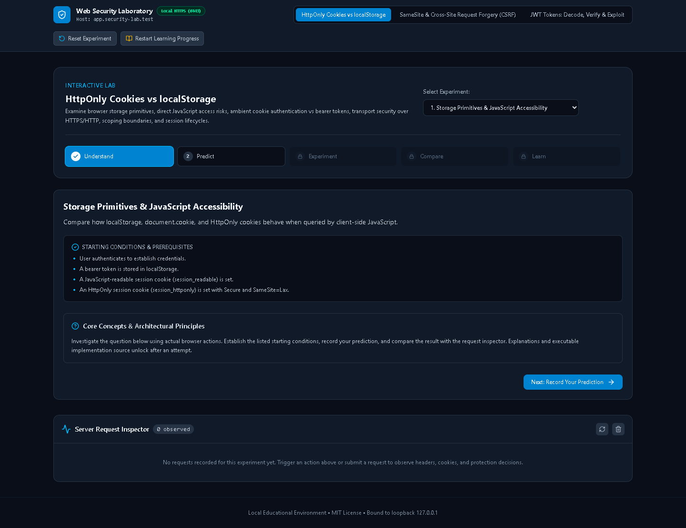
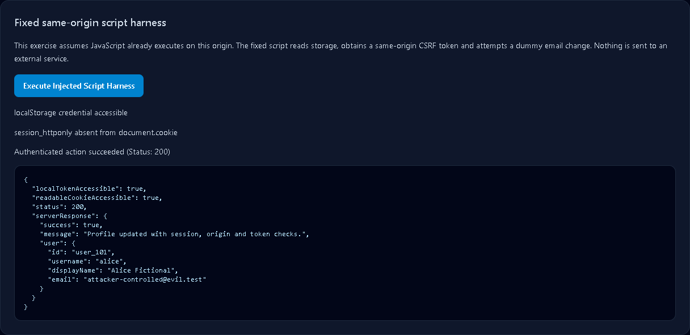
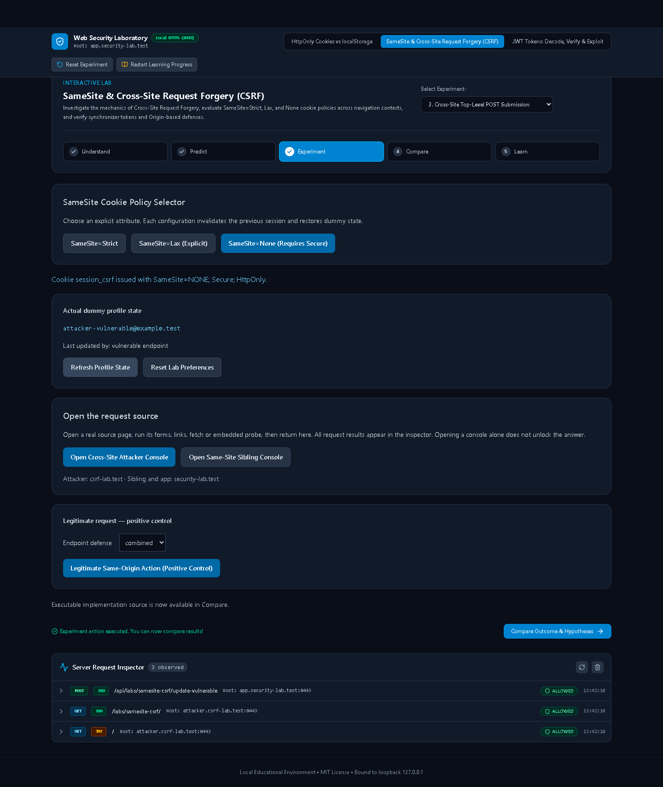
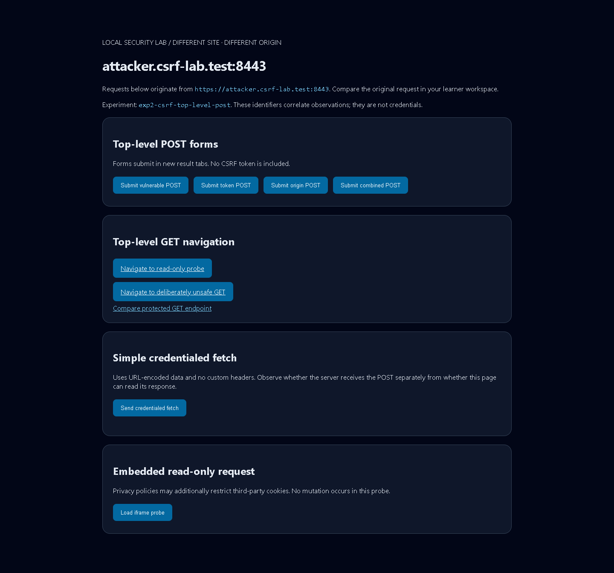
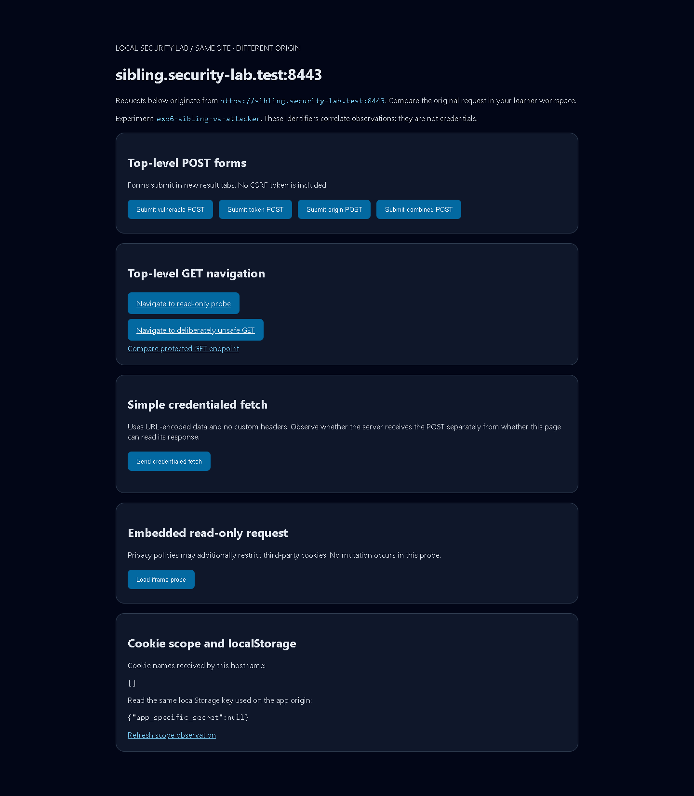

# Web Security Laboratory

[](LICENSE)
[](https://nodejs.org/)

A local browser laboratory for developers learning web security. Make a prediction, run a real request, inspect what happened, and compare vulnerable and protected implementations.

Built with **React, TypeScript, Vite, Express and Playwright**. This repository accompanies a personal Web Security Series; it supplies experiments and evidence, not social media posts.

> **Local use only.** This application intentionally includes vulnerable endpoints. Never deploy it, expose it through a tunnel or reverse proxy, or use real credentials or personal data. All listeners bind to `127.0.0.1`. Use a dedicated browser profile.



## Quick start

Prerequisites: Node.js 24, npm, Git and [mkcert](https://github.com/FiloSottile/mkcert). Initial dependency and browser installation require internet access. Runtime experiments use local services.

```sh
git clone https://github.com/adarshbam/security-lab.git
cd security-lab
npm install
```

Complete the one-time [trusted HTTPS and hosts setup](docs/setup.md), then:

```sh
npm run setup
npm run dev
```

Open **[https://app.security-lab.test:8443](https://app.security-lab.test:8443)**. Stop the server with Ctrl+C.

`npm run setup` generates ignored leaf certificates, installs the pinned Playwright Chromium browser and checks DNS, certificate validity, browser trust and ports. It **does not change your hosts file or trust store**. Incomplete setup returns a failing exit status; there is no self-signed or TLS-error-bypass fallback.

## Learn by experimenting

Every experiment uses five stages:

1. **Understand:** read the starting conditions and question.
2. **Predict:** choose a hypothesis; guessing incorrectly is useful.
3. **Experiment:** issue dummy credentials and perform the action.
4. **Compare:** inspect actual observations alongside the reference expectation and executable source.
5. **Learn:** read the explanation, limitations, challenges and primary references.

Issuing credentials or merely opening a console does not unlock explanations. Completing an experiment does. Answers unlock per experiment, and learner progress persists in localStorage independently of dummy authentication.

The **Request Inspector** records actual request headers, cookie names, authentication results, status codes and state transitions. Credential values are redacted. Browser-side response access errors are separate evidence: a CORS error does not prove that a mutation was prevented.

**Reset Experiment** resets the active lab, revokes its credentials and clears its cookie tuples and observations. **Restart Learning Progress** clears predictions and locks explanations without changing authentication or the other lab.

## The initial labs

### 01 · HttpOnly Cookies vs localStorage

Five experiments cover:

- Direct JavaScript access to localStorage, readable cookies and HttpOnly cookies.
- Automatic cookie authentication versus explicit bearer-header attachment.
- Secure cookies over HTTPS and their omission on HTTP, with a harmless non-Secure positive control.
- Host-only, domain, path and localStorage origin boundaries.
- Session cookies, persistent-cookie expiration, server TTL and explicit credential invalidation.

The readable cookie and HttpOnly cookie contain **different random credentials**. Separate endpoints prevent one authentication mechanism from masking another.

A fixed script harness assumes malicious JavaScript already executes on the app origin. It runs actual storage reads and obtains a CSRF token before attempting an authenticated dummy action. This illustrates the limits of HttpOnly without adding a general XSS lab. No credentials are transmitted externally.

[Lab 1 instructions and challenges](src/labs/cookie-storage/docs/README.md)

### 02 · SameSite & CSRF

Six experiments investigate explicit Strict, Lax and None cookies using legitimate, sibling and attacker pages:

- Top-level GET and URL-encoded POST requests.
- Credentialed simple fetch and embedded read-only requests.
- Vulnerable, synchronizer-token, exact-origin and combined protection variants.
- An explicitly unsafe GET mutation and a protected endpoint that rejects GET.
- Same-site versus same-origin boundaries.

Attack requests originate from the actual attacker or sibling page, never a mislabeled same-origin React form. Result tabs preserve the learner workspace.

None always includes Secure. Core CSRF assertions use top-level forms. Third-party-cookie restrictions may independently affect embedded/fetch requests; the inspector reports actual behavior rather than promising that None always sends cookies.

[Lab 2 instructions and challenges](src/labs/samesite-csrf/docs/README.md)

<details>
<summary>More screenshots — open after your first experiment</summary>






</details>

## Local topology

All names resolve to `127.0.0.1`; their different registrable domains make cross-site experiments meaningful.

| Address | Role |
| --- | --- |
| `https://app.security-lab.test:8443` | Legitimate React application and lab APIs |
| `https://sibling.security-lab.test:8443` | Same site, different origin |
| `https://attacker.csrf-lab.test:8443` | Different site and origin |
| `http://app.security-lab.test:8080` | Read-only Secure-cookie diagnostic |

Cookies are not isolated by port. localStorage is scoped to scheme, hostname and port. The Secure experiment uses a top-level HTTP navigation, avoiding mixed-content fetch blocking.

The runtime validates Host headers, rejects forwarded-proxy headers, bounds request bodies and keeps dummy state in memory. These guardrails do not make the vulnerable routes suitable for hosting. No HSTS is set because it would interfere with the deliberate HTTP probe.

## Commands

| Command | Purpose |
| --- | --- |
| `npm run setup` | Generate leaf certificates, install Chromium, verify setup |
| `npm run doctor` | Diagnose setup; stop the lab first so port checks are meaningful |
| `npm run dev` | Vite frontend and watched Express server over local HTTPS |
| `npm run build` | Type-check and build the frontend |
| `npm start` | Serve the built frontend with the same loopback lab APIs |
| `npm test` | Focused server tests and Chromium browser tests |
| `npm run test:e2e -- --headed` | Watch Chromium run the experiments |
| `npm run check` | Lint, type-check, build and run all tests |
| `npm run screenshots` | Regenerate documentation screenshots from real learner flows |

Stop a manually running lab before running tests or screenshots: these commands start their own server and deliberately refuse to reuse an unknown process.

## Test guarantees

Browser tests use fresh contexts, one worker and zero retries. They use trusted HTTPS, actual hostname resolution and real browser requests. There are no mocked network responses, injected cookie headers, pre-seeded browser cookie jars or security-disabling launch flags.

Tests pair failed attacks with vulnerable and legitimate positive controls. For CSRF, they assert received authentication, origin/Fetch Metadata, status and before/after server state. A browser CORS error, missing text or an unchanged page alone cannot pass a defense test.

Server tests cover origin/control guards, token binding, credential revocation, expiration and inspector redaction. GitHub Actions defines the same checks for Windows, macOS and Linux. Only Windows has been exercised locally; hosted matrix results must be verified after pushing the repository.

See [verification notes](docs/verification.md) and [contributor guidance](CONTRIBUTING.md).

## Architecture and extension

Each `src/labs/<id>/` contains its manifest, experiment definitions, client, Express router, state, docs and browser tests. Client/server registries keep executable code separate; shared contracts provide the learner interface and observation shape.

Executable snippets are imported from the real implementation as raw source regions. The inspector is server instrumentation; it cannot give browser JavaScript access to HttpOnly credentials or cross-origin response bodies.

[Architecture and adding a lab](docs/architecture.md)

## Troubleshooting and removal

See [setup, troubleshooting and removal](docs/setup.md). Common causes are missing hosts entries, an untrusted/expired certificate, occupied ports, a missing Chromium download or browser privacy settings that differ from the pinned reference browser. Do not resolve a test failure by disabling HTTPS validation or browser security.

## Primary references

- [MDN: Using HTTP cookies](https://developer.mozilla.org/en-US/docs/Web/HTTP/Guides/Cookies)
- [MDN: Set-Cookie](https://developer.mozilla.org/en-US/docs/Web/HTTP/Reference/Headers/Set-Cookie)
- [MDN: CORS](https://developer.mozilla.org/en-US/docs/Web/HTTP/Guides/CORS)
- [OWASP: Session Management Cheat Sheet](https://cheatsheetseries.owasp.org/cheatsheets/Session_Management_Cheat_Sheet.html)
- [OWASP: CSRF Prevention Cheat Sheet](https://cheatsheetseries.owasp.org/cheatsheets/Cross-Site_Request_Forgery_Prevention_Cheat_Sheet.html)

## Roadmap

Future independent modules may cover Broken Access Control, privilege escalation, SQL/NoSQL injection, XSS, security headers, clickjacking and other topics. They are not implemented in this release.

MIT licensed. Contributions should improve reproducibility, teaching accuracy and browser evidence.
