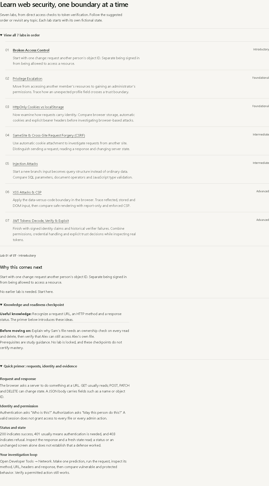

# Web Security Laboratory

A local browser lab for learning web security through predictions, real requests, and comparisons between vulnerable and protected implementations.

[Trusted setup](docs/setup.md) · [Learning guide](docs/LEARNING-GUIDE.md) · [Learning path](docs/learning-path.md) · [Architecture](docs/architecture.md) · [Verification](docs/verification.md)



## Seven connected labs

Follow the numbered path from request edits to browser boundaries and historical token-verification failures. Prerequisites are recommendations; every lab remains available. Labs share concepts, not credentials or runtime state. Existing lab IDs and saved learner progress remain valid.

| Lab | What you investigate | Guide |
| --- | --- | --- |
| 1 · Broken Access Control | Object ownership checks on file reads, deletion, and folder cascades | [Instructions](src/labs/broken-access-control/docs/README.md) |
| 2 · Privilege Escalation | Persisted role changes, profile allowlists, and member/admin controls | [Instructions](src/labs/privilege-escalation/docs/README.md) |
| 3 · Cookies and localStorage | JavaScript access, automatic authentication, Secure transport, scope, and lifetime | [Instructions](src/labs/cookie-storage/docs/README.md) |
| 4 · SameSite and CSRF | Cross-site requests, sibling origins, unsafe mutations, token and Origin checks | [Instructions](src/labs/samesite-csrf/docs/README.md) |
| 5 · Injection Attacks | Real SQLite parameters, document query operators, and JavaScript type coercion | [Instructions](src/labs/injection-attacks/docs/README.md) |
| 6 · XSS Attacks and CSP | Reflected, stored, and DOM input; safe rendering; report-only and enforced nonce policies | [Instructions](src/labs/xss-csp/docs/README.md) |
| 7 · JWT verification | Decode versus verify, historical algorithm/unsigned-token failures, cookie isolation, and request size | [Instructions](src/labs/exployting-jwt-tokens/docs/README.md) |

**Local use only.** The application intentionally contains vulnerable endpoints and historical dependencies. Never deploy it, tunnel it, or use real credentials/personal data. Listeners bind to 127.0.0.1; use a dedicated browser profile.

## Start locally

Use Node.js 24, npm, Git, and [mkcert](https://github.com/FiloSottile/mkcert). Clone/install, complete the explicit hosts/trust steps in [Setup](docs/setup.md), then:

```sh
npm install
npm run setup
npm run dev
```

Open [https://app.security-lab.test:8443](https://app.security-lab.test:8443). `setup` creates ignored leaf certificates, installs pinned Chromium, and checks local DNS/TLS trust. It does not edit hosts or the system trust store. There is no TLS-error-bypass fallback.

## Learn from observations

Understand → predict → experiment → compare → learn. Follow the Developer Tools tasks, record an observation, and compare actual evidence with executable source. Every stage and explanation remains available for exploration. Predictions, attempts, and concept checks structure practice; they do not establish mastery.

The request inspector reports received headers, cookie names, authentication outcomes, and state transitions while redacting credential values. A browser CORS error alone does not prove a mutation was prevented. [Evidence and reset behavior](docs/LEARNING-GUIDE.md).

Practice includes concept feedback, recall scheduling, reference-help attribution, and recent attempts. Learner records stay in localStorage separately from dummy authentication. Do not record credential values in notes. Resetting a lab revokes its credentials and resets its state; restarting learning progress clears practice records separately.

For a quick manual pass, open **30-minute guided review** in the app or follow the [timed checklist](docs/manual-review-30-minutes.md). It samples one experiment per lab rather than all 28 experiments. See the [learner quality review](docs/learner-quality-review.md) for coverage and limitations.

## Checks

```sh
npm run check
```

This runs lint, type checking, build, server checks, and browser checks through the repository scripts. Stop an existing lab first: tests start their own server and refuse to reuse an unknown process. [Commands and dated results](docs/verification.md).

React · TypeScript · Vite · Express · Playwright. [Contributing](CONTRIBUTING.md) · [MIT license](LICENSE).

The old JWT packages are intentional reproduction dependencies, not a clean-audit claim. [Historical versions](src/labs/exployting-jwt-tokens/docs/historical-versions.md). Future authentication-abuse, CORS, and clickjacking modules remain proposals; injection and XSS/CSP are implemented.
