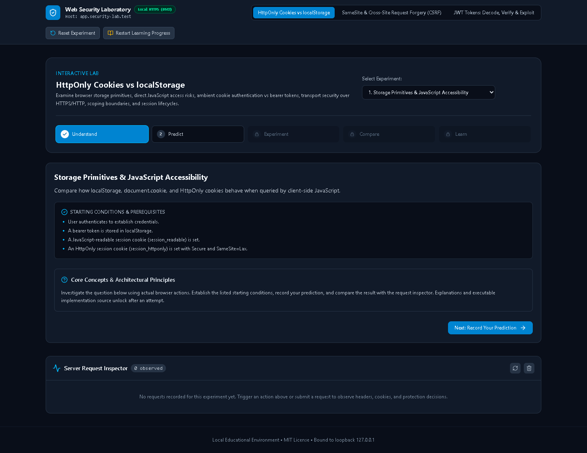

# Web Security Laboratory

A local browser lab for learning web security through predictions, real requests, and comparisons between vulnerable and protected implementations.

[Trusted setup](docs/setup.md) · [Learning guide](docs/LEARNING-GUIDE.md) · [Architecture](docs/architecture.md) · [Verification](docs/verification.md)



## Three connected labs

| Module | What you investigate | Guide |
| --- | --- | --- |
| Cookies and localStorage | JavaScript access, automatic authentication, Secure transport, scope, and lifetime | [Lab 1](src/labs/cookie-storage/docs/README.md) |
| SameSite and CSRF | Cross-site requests, sibling origins, unsafe mutations, token and Origin checks | [Lab 2](src/labs/samesite-csrf/docs/README.md) |
| JWT verification | Decode versus verify, historical algorithm/unsigned-token failures, cookie isolation, and request size | [Lab 3](src/labs/exployting-jwt-tokens/docs/README.md) |

**Local use only.** The application intentionally contains vulnerable endpoints and historical dependencies. Never deploy it, tunnel it, or use real credentials/personal data. Listeners bind to 127.0.0.1; use a dedicated browser profile.

## Start locally

Use Node.js 24, npm, Git, and [mkcert](https://github.com/FiloSottile/mkcert). Clone/install, complete the explicit hosts/trust steps in [Setup](docs/setup.md), then:

```sh
npm install
npm run setup
npm run dev
```

Open [https://app.security-lab.test:8443](https://app.security-lab.test:8443). `setup` creates ignored leaf certificates, installs pinned Chromium, and checks local DNS/TLS trust. It does not edit hosts or the system trust store. There is no TLS-error-bypass fallback.

## Learn from observations

Predict → run the experiment → inspect the request/state → compare → read the explanation. Issuing dummy credentials alone does not complete an experiment.

The request inspector reports received headers, cookie names, authentication outcomes, and state transitions while redacting credential values. A browser CORS error alone does not prove a mutation was prevented. [Evidence and reset behavior](docs/LEARNING-GUIDE.md).

## Checks

```sh
npm run check
```

This runs lint, type checking, build, server checks, and browser checks through the repository scripts. Stop an existing lab first: tests start their own server and refuse to reuse an unknown process. [Commands and dated results](docs/verification.md).

React · TypeScript · Vite · Express · Playwright. [Contributing](CONTRIBUTING.md) · [MIT license](LICENSE).

The old JWT packages are intentional reproduction dependencies, not a clean-audit claim. Future SQL/NoSQL injection, general XSS, and other proposed modules are not implemented here. [Historical versions](src/labs/exployting-jwt-tokens/docs/historical-versions.md).
